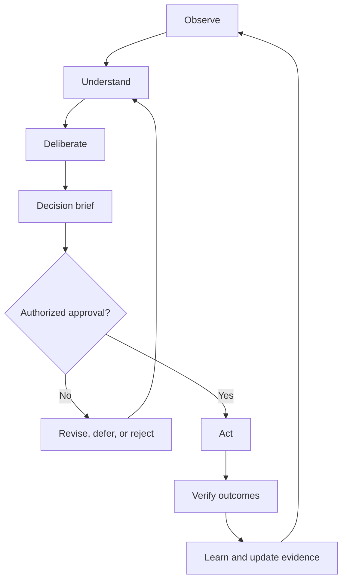
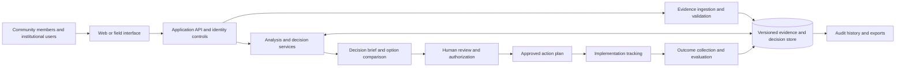

# Atlas Regenerative Decision Engine (ARDE)

> **Atlas Sanctum — Intelligence in service of truth, stewardship, and human flourishing.**

The **Atlas Regenerative Decision Engine (ARDE)** is a proposed place-based decision-intelligence system that connects evidence, human needs, institutional rules, authorized action, and measured outcomes.

Its fundamental unit is not a chatbot conversation or an AI agent. It is a **decision that can be explained, challenged, authorized, executed, measured, and improved**.

> **Project status:** Concept / design proposal. This README describes the intended product and an initial implementation direction; it does not claim that the described capabilities have already been implemented or independently validated.

## Contents

- [Why Atlas](#why-atlas)
- [Design principles](#design-principles)
- [The decision lifecycle](#the-decision-lifecycle)
- [System components](#system-components)
- [High-level architecture](#high-level-architecture)
- [Core decision record](#core-decision-record)
- [Illustrative example](#illustrative-example)
- [MVP scope](#mvp-scope)
- [Suggested implementation approach](#suggested-implementation-approach)
- [Security, governance, and responsible use](#security-governance-and-responsible-use)
- [Evaluation](#evaluation)
- [Proposed repository structure](#proposed-repository-structure)
- [Roadmap](#roadmap)
- [Contributing](#contributing)
- [License](#license)

## Why Atlas

Important decisions about places and shared resources are often made using fragmented datasets, inconsistent reporting, local knowledge that is difficult to represent in formal systems, and recommendations that are hard to audit after the fact.

ARDE is intended to help an organization move from fragmented information to an accountable decision process:

- **Observe:** gather credible evidence about a place and problem.
- **Understand:** connect claims to sources and make uncertainty visible.
- **Deliberate:** compare feasible options, affected interests, and constraints.
- **Decide:** document a recommendation and obtain the appropriate human authorization.
- **Act:** coordinate the approved intervention and its responsibilities.
- **Verify:** compare observed outcomes against a baseline.
- **Learn:** update the evidence and improve future decisions.

The first deployment should address **one clearly bounded decision problem** for a real organization. A broad, universal decision platform is a long-term possibility—not a prerequisite for a useful first product.

## Design principles

| Principle | How it should appear in the system |
| --- | --- |
| **Traceability** | Consequential claims link to sources, methods, dates, and limitations. |
| **Epistemic humility** | Uncertainty, disagreement, stale data, and missing evidence are explicitly represented. |
| **Human agency** | Authorized people and institutions remain accountable for consequential decisions. |
| **Justice and inclusion** | Analysis examines who benefits, who bears risks, and who may be excluded. |
| **Stewardship** | Long-term, ecological, and intergenerational effects can be considered. |
| **Contestability** | People can review, challenge, correct, or appeal material errors through appropriate processes. |
| **Learning** | Predictions and intentions are compared with verified observations after action. |
| **Proportionality** | The system uses the simplest technology that adequately solves the demonstrated problem. |

These principles are product and governance commitments to implement and evaluate. They are not proof that a system is inherently fair, accurate, or beneficial.

## The decision lifecycle



Approval is an explicit gate. The system may help assemble evidence, generate options, and draft plans, but it must not silently convert an AI-generated recommendation into institutional authorization.

## System components

### 1. Evidence Graph

Connect observations, datasets, publications, community reports, hypotheses, model outputs, and unresolved questions.

A claim should distinguish among direct observation, documentary evidence, statistical association, causal hypothesis, expert judgment, and model-generated inference. Where available, record source provenance, collection date, geographic scope, units, licensing, and quality limitations.

### 2. Human Flourishing Model

Make relevant human consequences visible: for example, health, water and food security, livelihoods, safety, access, dignity, opportunity, and resilience.

Avoid treating human flourishing as one universal score. Show trade-offs and distributional effects so that affected people and accountable decision-makers can evaluate different priorities.

### 3. Commons Governance Map

Represent relevant people and institutions, shared resources, applicable rules, responsibilities, access rights, consultation requirements, and known disputes.

Distinguish verified legal requirements from local practices, voluntary commitments, contested claims, and system assumptions. The software should not invent legal authority or resolve disputes merely by ranking competing claims.

### 4. Decision Brief

Produce a reviewable comparison of feasible options, including inaction where appropriate. Capture expected benefits, costs, uncertainty, relevant constraints, foreseeable harms, sensitivity to assumptions, and the information that could change the recommendation.

### 5. Coordination and Capital Layer

Turn an approved decision into an implementation plan with named responsibilities, milestones, dependencies, funding status, and verification requirements.

Keep proposed funding separate from approved budgets, commitments, disbursements, and verified expenditure. Financial transfers and legally consequential actions require the appropriate external controls and authorization.

### 6. Outcome and Learning Ledger

Record the baseline, intended result, intervention, actual observations, implementation quality, costs, unintended consequences, and evaluation limits.

Distinguish measured changes from causal attribution. Preserve decision history and document corrections instead of silently rewriting consequential records.

## High-level architecture

The architecture below is a conceptual reference. Specific technologies should be selected only after validating the first use case, its users, data constraints, security requirements, and operational budget.



### Architectural expectations

- Keep the canonical decision record understandable independently of any particular AI vendor.
- Maintain a clear boundary between model-generated suggestions and approved actions.
- Store source metadata and decision versions, not just generated summaries.
- Apply access controls at both the application and data layers.
- Provide export and correction mechanisms appropriate to the sensitivity of the information.
- Treat imported documents, web content, and user-submitted data as untrusted inputs.
- Define failure behavior for unavailable data sources, model errors, integration outages, and incomplete approvals.

## Core decision record

A canonical record should link:

`Decision ID → Place → Problem → Evidence → Options → Uncertainty → Affected parties → Governing rules → Recommendation → Authorization → Action plan → Outcomes → Lessons`

The following is an **illustrative schema**, not a production contract. Field names and validation requirements should be adapted to the selected pilot.

```json
{
  "decision_id": "decision-example-001",
  "status": "draft",
  "title": "Prioritize a local water-access intervention",
  "place": {
    "place_id": "place-example-001",
    "name": "Pilot area",
    "geometry_ref": null
  },
  "problem": {
    "statement": "Determine which intervention should be assessed first to improve reliable access to water.",
    "baseline_ref": null,
    "created_at": "YYYY-MM-DD"
  },
  "evidence": [
    {
      "evidence_id": "evidence-example-001",
      "claim": "Example claim requiring verification",
      "evidence_type": "documentary",
      "source_uri": null,
      "observed_at": null,
      "geographic_scope": "Pilot area",
      "limitations": [
        "Source and measurement method have not yet been validated."
      ],
      "confidence": "unassessed"
    }
  ],
  "options": [
    {
      "option_id": "option-a",
      "name": "Assess repair of existing infrastructure",
      "estimated_cost": null,
      "expected_benefits": [],
      "risks": [],
      "assumptions": []
    }
  ],
  "affected_parties": [],
  "governing_rules": [],
  "uncertainties": [],
  "recommendation": {
    "option_id": null,
    "rationale": null,
    "review_required": true
  },
  "authorization": {
    "required": true,
    "decision_maker_id": null,
    "status": "not_requested",
    "approved_at": null
  },
  "action_plan": [],
  "outcomes": [],
  "lessons": [],
  "version": 1
}
```

**Implementation note:** Use real timestamps, stable identifiers, typed quantities and units, explicit source permissions, and validated schemas in a production implementation. Do not interpret example values as collected field data.

## Illustrative example

Consider an organization deciding how to improve water reliability in a defined area.

1. **Observe:** collect available service records, infrastructure assessments, water-quality information, community reports, costs, and applicable requirements.
2. **Understand:** check source quality and date, map where coverage is incomplete, and distinguish observations from unverified reports.
3. **Deliberate:** compare feasible actions such as repairing existing infrastructure, improving monitoring, or assessing an alternative supply. Include doing nothing as a comparison when relevant.
4. **Decide:** present costs, assumptions, possible harms, unresolved questions, and the distribution of expected benefits. The responsible organization reviews and authorizes the action.
5. **Act:** assign accountable owners, budget status, milestones, and monitoring responsibilities.
6. **Verify:** compare service reliability and other agreed indicators with the baseline, noting missing or conflicting data.
7. **Learn:** document what changed, what remains uncertain, and whether the intervention should continue or be revised.

This example demonstrates the intended workflow; it does **not** claim a measured improvement or recommend a specific intervention without local evidence.

## MVP scope

The initial minimum viable product should demonstrate one complete, auditable decision cycle. Suggested first capabilities:

- A place and problem record.
- Evidence register with source, date, provenance, and limitations.
- Structured decision brief and a side-by-side option comparison.
- Explicit uncertainty and missing-evidence sections.
- Human review, approval status, and a record of who authorized an action.
- An implementation plan with responsible owners and milestones.
- Outcome baseline, follow-up measurements, and lessons learned.
- Exportable records and a basic audit trail.

### Out of scope for the first version

Unless the pilot proves a compelling need, defer autonomous action execution, automatic release of funds, a universal civilization-scale digital twin, a custom foundation model, complex multi-agent orchestration, and blockchain-based records. These add operational and governance burdens and are not prerequisites for testing the core proposition.

## Suggested implementation approach

No stack is mandated by this concept. For a first pilot, prefer maintainable, widely supported components and a simple deployment that the team can operate reliably.

| Layer | Initial responsibility | Selection criteria |
| --- | --- | --- |
| User interface | Evidence review, decision briefs, approvals, follow-up | Accessibility, mobile usability, offline constraints |
| Application API | Validation, permissions, workflow, integrations | Clear contracts, testability, operational familiarity |
| Relational data store | Decisions, actors, approvals, outcomes, metadata | Integrity, migrations, backup, access controls |
| Geospatial capability | Place references and spatial queries where needed | Required coordinate systems, data quality, scale |
| Evidence storage | Authorized files and source snapshots or references | Licensing, privacy, retention, provenance |
| Analysis services | Rules, statistics, option comparison, optional AI support | Reproducibility, evaluation, explainability |
| Audit and observability | Events, errors, versions, review history | Searchability, protected logs, incident response |

Use AI where it demonstrably helps with tasks such as extracting candidate claims from documents, summarizing evidence with citations, or drafting structured briefs. Require verification for material claims and never treat fluent language as a substitute for source evidence.

### Local development

A concrete development setup should be documented once this repository contains an implemented application. Until then, there is no verified application command, environment variable set, deployment configuration, or live service to provide.

A future implementation should include, at minimum:

- A documented and reproducible setup process.
- Example environment configuration with secrets excluded.
- Database migrations and seed data clearly labelled as synthetic.
- Automated unit and integration tests.
- A security and privacy review before real community data is used.
- Deployment, backup, recovery, and rollback instructions.

## Security, governance, and responsible use

ARDE may process sensitive community, organizational, environmental, or infrastructure information. The pilot must establish a data-governance plan before collecting it.

- **Data minimization:** collect only what is necessary for the stated purpose.
- **Purpose and access limits:** document why data is collected and who may use it.
- **Consent and consultation:** use context-appropriate participation and authorization procedures.
- **Privacy and retention:** define retention, deletion, aggregation, and publication rules.
- **Source integrity:** validate uploaded files and treat external content as untrusted.
- **AI safety:** defend against prompt injection, unsupported claims, data poisoning, and overconfident outputs.
- **Human authorization:** keep approval separate from recommendation generation.
- **Contestability:** provide a documented route to challenge or correct consequential errors.
- **Auditability:** record meaningful changes to decisions, permissions, approvals, and outcomes.
- **Fairness review:** assess who may benefit, who may be harmed, and whose evidence is missing.
- **Operational resilience:** plan for outages, backups, access revocation, and incident response.

Legal and regulatory requirements vary by jurisdiction and application. Obtain qualified review for the selected deployment; this README is not legal advice.

## Evaluation

Treat claims of improved decision-making as hypotheses to test, not marketing copy.

Potential evaluation questions include:

- Does structured provenance reduce the time required to audit a recommendation?
- Does explicit uncertainty reporting help reviewers notice weak assumptions?
- Does distributional analysis expose harms missed by aggregate indicators?
- Do versioned decision records improve continuity when personnel change?
- Can a real team maintain the records and outcome measures at an acceptable cost?
- Do interventions produce better outcomes than the existing workflow, and how strong is the evidence for attribution?

For each pilot, define a baseline, measurement plan, responsible evaluator, confounders, success thresholds, and stop conditions before deployment. Track technical reliability, user experience, governance compliance, operational usefulness, and real-world outcomes separately. Publish negative findings and limitations where sharing them is safe and permitted.

## Proposed repository structure

The repository may evolve toward a structure such as:

```text
.
├── README.md
├── docs/
│   ├── architecture.md
│   ├── decision-lifecycle.md
│   ├── data-governance.md
│   ├── threat-model.md
│   ├── evaluation-plan.md
│   └── adr/                 # Architecture decision records
├── schemas/
│   ├── decision-record.schema.json
│   └── evidence-record.schema.json
├── examples/
│   └── synthetic-decision-record.json
├── apps/                    # User-facing applications, when implemented
├── services/                # APIs and analysis services, when implemented
├── tests/
└── LICENSE
```

This is a proposed layout, not a description of files that already exist.

## Roadmap

### Phase 0 — Validate the problem

- Select one use case and a defined geographic scope.
- Interview intended users and affected stakeholders.
- Map the current decision process and its measurable shortcomings.
- Identify lawful, relevant, and sufficiently reliable data sources.
- Agree on a baseline, outcome measures, and stop conditions.

### Phase 1 — Build the decision-record prototype

- Implement the core schema and evidence register.
- Create a decision brief and options comparison.
- Add review and authorization states.
- Add an implementation plan, follow-up record, and audit history.
- Test using synthetic or properly authorized data.

### Phase 2 — Run a bounded pilot

- Work with an accountable partner.
- Compare the workflow with current practice.
- Measure reliability, time, cost, usability, and governance performance.
- Document limitations and unexpected effects.

### Phase 3 — Earn the right to expand

Expand to additional data sources, geospatial analysis, integrations, or use cases only when pilot evidence supports the investment and the governance model can accommodate the new risks.

## Contributing

Contributions are welcome in research, engineering, geospatial analysis, governance, evaluation, accessibility, documentation, and field-partner engagement.

Before proposing a new subsystem, describe:

1. The concrete problem it solves.
2. The users and affected groups.
3. The evidence that the problem exists.
4. The simplest viable solution and alternatives considered.
5. The risks, uncertainties, and maintenance burden.
6. How the contribution can be tested.

Keep pull requests focused. Include tests and documentation for behavior changes. Do not submit personal, confidential, or sensitive community information to examples or test fixtures. Use clearly labelled synthetic data unless authorization for real data is established.

## License

No license is specified by this concept document. Before publishing implementation code, choose and add an explicit license covering code and clarify the terms applying to documentation, datasets, and contributions. Until a license is added, do not assume that reuse is permitted.

---

**Atlas Sanctum — Build with civilizational ambition. Engineer with disciplined restraint.**

Start by helping one real institution make one important decision better, carry it through responsibly, and determine with credible evidence whether the outcome improved.
